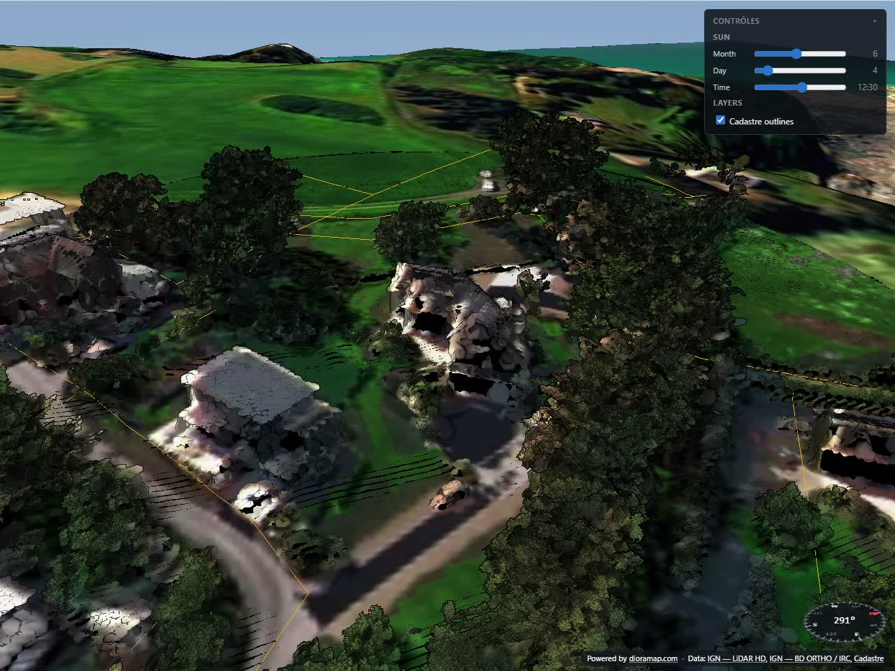
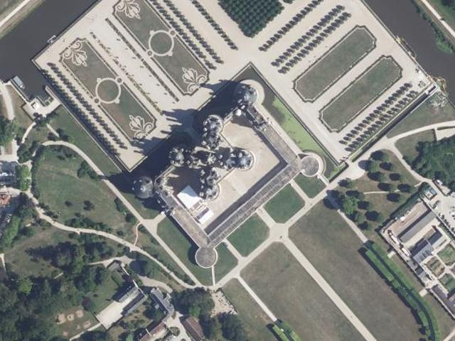
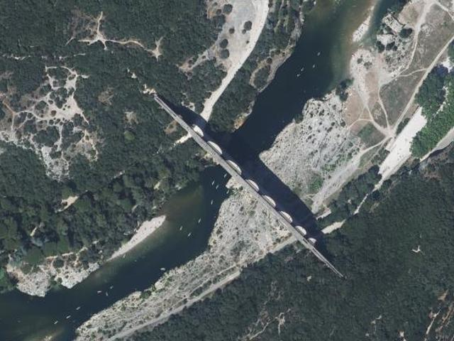
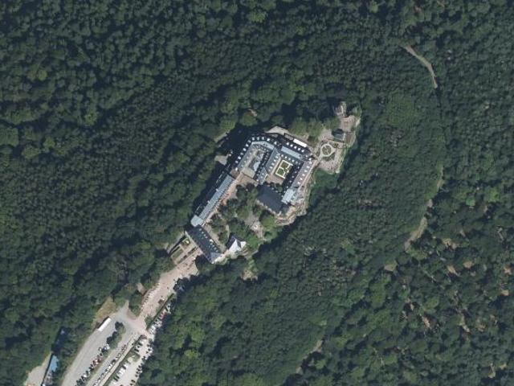
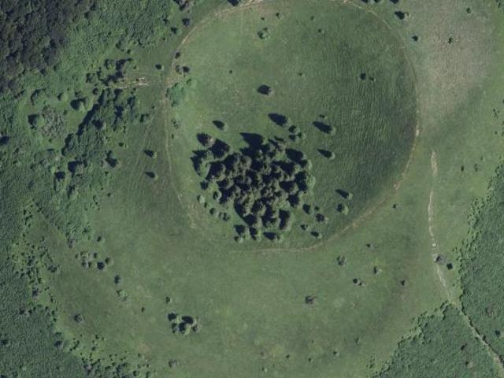
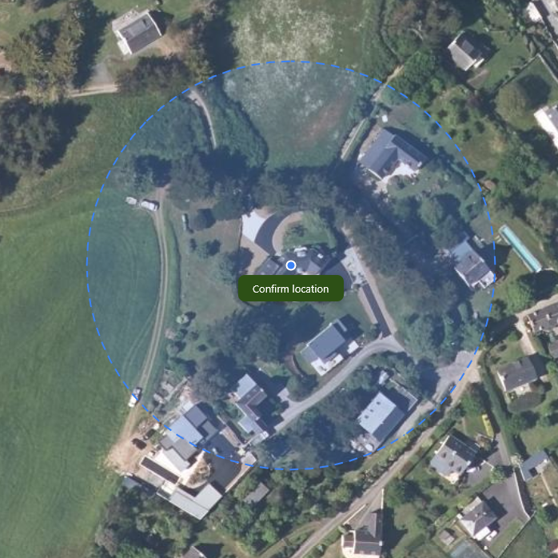
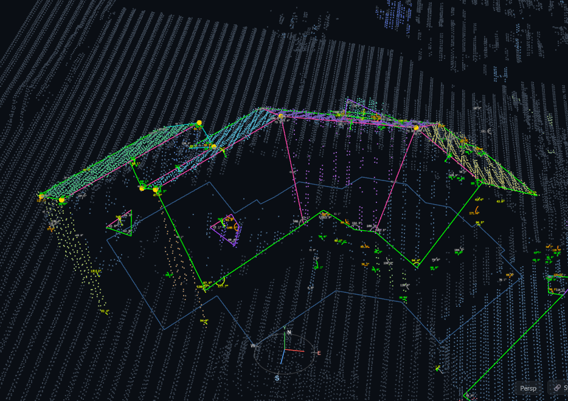

# Dioramap Lab: aerial LiDAR to 3D buildings and scenes

[](https://doi.org/10.5281/zenodo.24443302)
[](https://github.com/FL-AntoineDurand/dioramap-lab/actions/workflows/ci.yml)
[](LICENSE)

<p align="center">
  <a href="docs/assets/scene-3d.mp4"></a><br>
  <sub>A scene built from IGN LiDAR HD + BD ORTHO + cadastre, rendered by the embeddable viewer
  (<a href="docs/assets/scene-3d.mp4">video</a>).</sub>
</p>

**Dioramap Lab** is a C engine and browser lab for turning **open aerial LiDAR point
clouds** into **3D building models (LoD2 roof reconstruction)** and **3D scenes of real
places** you can embed in any web page. Give it a French address: it downloads the
**COPC** LiDAR tiles, orthophotos, elevation and cadastre on demand, co-registers them,
classifies ground and vegetation, removes shadows from the photo, and streams the scene
to a three.js viewer over WebSocket. Give it a building: it segments the **roof
planes**, builds the roof topology and outlines, regularizes them and detects walls.

It targets **IGN LiDAR HD** (France) today. Data-provider plugins for other national
LiDAR programmes are on the [roadmap](#roadmap).

> **Status: research release (v0.1).** Maintained on a best-effort basis. APIs and
> file formats may change.

**Contents:** [What's in the repo](#whats-in-the-repo) ·
[The engine](#the-engine) · [3D scenes of real places](#3d-scenes-of-real-places) ·
[Embedding the viewer](#embedding-the-viewer) ·
[Building reconstruction](#building-reconstruction-roof-planes-to-lod2) ·
[Quickstart](#quickstart) · [Layout](#repository-layout) · [Roadmap](#roadmap)

## What's in the repo

| Part | What it is |
|---|---|
| **Engine** (`core/`) | `dioramap-processor`: a C11 step-graph runner with a content-addressed cache, a batch CLI and a WebSocket server |
| **Steps** (`steps/`) | the processing algorithms: data fetchers, COPC/LAZ reading, rasters, co-registration, classification, ground, shadows, and the `v7` roof reconstruction chain |
| **Pipelines** (`pipelines/smoke/`) | JSON graphs that wire steps together, from a single slice (`viewer-pointcloud.json`) to the full scene (`viewer-full.json`) and the roof chain (`v7.json`) |
| **Lab UI** (`apps/lab-ui`) | the browser workbench: pick a pipeline, run it, inspect every artifact in 2D or 3D, browse the DAG and the run history |
| **Viewer SDK** (`apps/viewer-sdk`) | an embeddable 3D viewer for one place, with sun, shadows, compass and GLB model placement |
| **Location picker** (`apps/location-picker`) | a MapLibre address search and disc picker on IGN basemaps |
| **Shared JS** (`apps/scene-base`, `apps/protocol`) | three.js scene composers and the WebSocket protocol client, used by the lab and the SDK |
| **Data** (`data/test-cases/`) | 44 real-building LiDAR extracts from IGN LiDAR HD, ready to run offline |
| **Docs** (`docs/`) | architecture, hash model, plans, quality, glossary, and a 188-entry research journal |

## The engine

Everything is a **step**: a small C function with declared inputs, outputs and
parameters, and a version number. A **pipeline** is a JSON list of steps; the loader
wires them into a DAG by artifact name.

- **Content-addressed cache.** Each output is keyed by a hash of its step version,
  parameters and input hashes. Re-running a pipeline only recomputes what changed;
  bumping one step's version invalidates exactly its downstream
  ([docs/HASH-MODEL.md](docs/HASH-MODEL.md)).
- **Two front ends, one runner.**
  - `dioramap-processor batch` runs a pipeline from the command line and writes
    artifacts to a directory.
  - `dioramap-processor serve` exposes the catalog over WebSocket: clients pick a
    pipeline, send inputs, subscribe to artifacts and receive them as they're
    produced.
- **Typed binary artifacts** (point clouds, rasters, roof graphs, meshes), each with a
  `.doc.json` describing its format, plus a JSON inspector.
- **Built for correctness:** ASan/UBSan/TSan builds, libFuzzer targets, Frama-C,
  `-Werror`, 60 CTest suites ([docs/quality/README.md](docs/quality/README.md)).

See [docs/UNIFIED-ARCHITECTURE.md](docs/UNIFIED-ARCHITECTURE.md) for the full design.

## 3D scenes of real places

`pipelines/smoke/viewer-full.json` turns a latitude/longitude and a radius into a
complete 3D scene. The chain, in order:

1. **Locate.** Canonicalize the address and choose a local scene origin.
2. **Fetch, on demand and cached.** LiDAR HD COPC tiles, cut to a disc; BD ORTHO
   colour and infrared orthophotos; elevation; cadastre buildings and parcels; a
   lower-resolution surround for the horizon.
3. **Rasterize.** LiDAR rasters, normalized surface model (nDSM), building mask, ortho
   rasters.
4. **Co-register.** Align the orthophoto to the LiDAR, then fit the cadastre outlines
   to the LiDAR buildings.
5. **Classify.** Point normals, NDVI from the infrared photo, normal scatter and
   near-building masks, then vegetation.
6. **Ground and parcels.** Ground surface from LiDAR, parcel lines draped on it.
7. **Shadows.** Detect shadows in the photo, recover **when the photo was taken** by
   matching them against shadows cast from the LiDAR surface model, then **deshadow**
   the orthophoto, so the scene can be lit for any date and time.

<p align="center">
  
  
  
  <br>
  <sub>Any place covered by LiDAR HD works: Chambord, Pont du Gard, Mont Sainte-Odile, Puy de Côme.</sub>
</p>

Pick the place with `apps/location-picker`, an address search and disc picker on IGN
basemaps:

<p align="center"></p>

Each stage also exists as a smaller pipeline (`viewer-coreg.json`,
`viewer-shadows.json`, `viewer-deshadow.json`, …) so you can run and inspect it alone in
the lab UI.

## Embedding the viewer

`apps/viewer-sdk` builds to a single script with three.js bundled in. It connects to a
`dioramap-processor serve` instance, runs `viewer-full` for the given place and renders
the result.

```bash
cd apps/viewer-sdk && npm ci && npm run build
# → dist/dioramap-viewer.umd.js, dist/dioramap-viewer.es.js, dist/style.css
```

```html
<link rel="stylesheet" href="style.css">
<div id="scene" style="width:100%; height:480px"></div>
<script src="dioramap-viewer.umd.js"></script>
<script>
  DioramapViewer.init({
    container: '#scene',
    backendUrl: 'ws://127.0.0.1:7801/',   // your dioramap-processor
    lat: 48.8530, lon: 2.3499, radius: 75,   // Notre-Dame de Paris
    onReady: (viewer) => {
      viewer.setSunTime(new Date('2026-06-21T18:00:00Z'));
      // Let the user drop a 3D model (garden shed, pool, extension…) on the ground:
      viewer.startGhostPlace({ url: '/models/cabin-shed.glb' });   // any GLB you host
    },
  });
</script>
```

The handle also offers `addModel`, `removeModel`, `getModels`, `selectModel`,
`setGizmoMode` and `setModelTransform` to place, move and list models, which is how you
preview a project in its real surroundings. Three sample GLB models ship in
`apps/viewer-sdk/public/models/`.

## Building reconstruction: roof planes to LoD2

<p align="center"></p>
<p align="center"><sub>A reconstructed roof graph in the lab UI: points coloured by plane,
ridges (pink), shared corners (yellow), outlines (green), cadastre footprint (blue).</sub></p>

`pipelines/smoke/v7.json` reconstructs the roofs of one building from its LiDAR points.
It runs on the bundled test cases; pick one with the `spec` parameter of the first step.
The steps, in execution order:

| # | Step | What it does |
|---|---|---|
| 1 | `v7-load-real-test-case` | Load a bundled LiDAR extract: positions, classes, scan angles, flight-strip ids and return numbers |
| 2 | `extract-buildings` | Collect the points within a buffer around each cadastre footprint, one record per building |
| 3 | `build-building-kd-trees` | Build one k-d tree per building, shared by every later neighbourhood query |
| 4 | `v7-derive-thresholds` | Derive per-building thresholds from point density, so gates adapt to sparse or dense scans |
| 5 | `v7-tile-signals` | Per-point PCA features: normals, planarity, multi-scale curvature, plus Voronoi-area weights that compensate uneven density |
| 6 | `v7-beam-incidence` | Recover each laser beam's direction per flight strip from scan angles; beams that pass through mark "no roof here" |
| 7 | `v7-hemisphere-segment` | Cluster normals on an equal-area hemisphere, then split each orientation group into coplanar segments |
| 8 | `v7-normal-cascade-seed` | Turn the segments into seed planes, skipping ridge and valley transitions by curvature |
| 9 | `v7-density-voids-2` | Find point-density holes (LiDAR dropout, glass, dark roofing) and propose "ghost" plane seeds there |
| 10 | `v7-grow-refit-merge` | Iterate: grow planes, refit them per flight strip, merge coplanar neighbours, until stable |
| 11 | `v7-boundary-topology` | Build the roof graph skeleton: planes, ridges (hips, valleys, eaves) and ridge lines |
| 12 | `v7-boundary-signals` | Add per-plane boundary evidence: ray-cast projections and open-angle, centre-of-mass and balance grids |
| 13 | `v7-boundary-corners` | Build one pool of corners from ridge intersections, ridge ends and concave/convex anchors, shared only between planes of the same type |
| 14 | `v7-boundary-polygons-2` | Trace each plane's outline polygon by choosing the corner subset and order that minimizes a coverage and shape cost |
| 15 | `v7-boundary-regularize` | Move corners to their best positions under degree-of-freedom constraints, welding and sharing corners where planes meet |
| 16 | `v7-boundary-classify` | Label every outline edge: eave, shared, overhang, wall, level step |
| 17 | `v7-wall-detect` | Detect wall planes below the eaves and add them, with their corners and outlines, to the roof graph |
| 18 | `v7-score-intrinsic` | Score the roof model without ground truth: completeness and point-to-plane residuals |
| 19 | `v7-score-intrinsic-postwall` | The same score over the full model with walls, showing what wall detection added |

The output is a **roof graph** (planes, ridges, corners, outline polygons) that the lab
UI draws in 2D and 3D. The design rationale for every stage is in the research journal
([docs/journal/](docs/journal/)), and internal names are explained in
[docs/GLOSSARY.md](docs/GLOSSARY.md).

## Quickstart

Tested on Ubuntu 24.04 and 26.04. The browser apps need **Node.js 20+** (Ubuntu 24.04's `nodejs` package is 18; use NodeSource or `nvm`).

```bash
sudo apt-get install -y build-essential cmake ninja-build pkg-config nodejs npm \
  libwebsockets-dev libcurl4-openssl-dev libproj-dev libjpeg-dev libjansson-dev \
  libsqlite3-dev libssl-dev libxxhash-dev libwebp-dev python3-websockets

git clone https://github.com/FL-AntoineDurand/dioramap-lab.git && cd dioramap-lab
./scripts/fetch-third-party.sh                 # copc-lib + laz-perf, pinned
cmake -S core -B build -G Ninja -DCMAKE_BUILD_TYPE=Release
ninja -C build && ctest --test-dir build
```

**Reconstruct roofs on a bundled building** (about 1–2 minutes on one CPU core, instant
on re-runs thanks to the cache):

```bash
./build/dioramap-processor batch \
  --pipeline pipelines/smoke/v7.json --input-json '{}' \
  --produce model-score-postwall,wall-detect-roof-graph --output-dir out/
```

**Stream a 3D scene of any French address into the lab UI:**

```bash
./build/dioramap-processor serve --pipelines-dir pipelines/smoke   # ws://127.0.0.1:7801
cd apps/lab-ui && npm ci && npm run dev                      # http://127.0.0.1:5181
```

The server listens on `127.0.0.1` with no authentication by default. To expose it,
use `--bind <addr>` together with `--token <secret>`; clients then connect with
`?token=…` (or pass `token` to `DioramapViewer.init`). See [SECURITY.md](SECURITY.md).

**Docker:**

```bash
docker build -t dioramap-processor .
docker run --rm -p 127.0.0.1:7801:7801 dioramap-processor
```

## Repository layout

```
core/        engine: runner, content-addressed store, pipeline loader, WebSocket server
steps/       processing steps (v7 roof reconstruction, copc, fetchers, registration, shadow, …)
pipelines/   pipeline definitions (JSON)
apps/        lab-ui, viewer-sdk, scene-base, protocol, location-picker (JS, Vite)
data/        real-building LiDAR test cases (IGN LiDAR HD extracts)
tests/       baselines, fixtures, model-validity checks
scripts/     third-party fetch, CI tiers, Frama-C harnesses
docs/        architecture, plans, quality, research journal, glossary
```

New to the codebase? Start with [docs/GLOSSARY.md](docs/GLOSSARY.md). Internal names
like *v7*, *GRM*, *bp2* or *WSD* are explained there.

## Roadmap

- Extend `laz-extract-disc` with scan angle, point source ID and return numbers, so
  the v7 roof chain runs directly from an address (`v7-from-address`)
- Data-provider interface for other countries: 🇳🇱 AHN, 🇺🇸 USGS 3DEP, 🇩🇰, 🇪🇸 PNOA,
  🇨🇭 swisstopo, 🇬🇧 EA, 🇦🇹, plus OSM/Overture footprints
- CityJSON / glTF export of reconstructed buildings

## Contributing

Issues and pull requests are welcome. See [CONTRIBUTING.md](CONTRIBUTING.md); commits
are signed off under the DCO.

## Licence

Code: **[Apache License 2.0](LICENSE)**, © 2026 Antoine Durand. See [NOTICE](NOTICE)
for third-party components.
Data: IGN LiDAR HD, BD ORTHO, BD TOPO and cadastre extracts, © IGN, under
[Licence Ouverte 2.0](DATA-LICENSE.md).

## Citation

If you use Dioramap Lab in research, please cite it via [CITATION.cff](CITATION.cff)
(GitHub's "Cite this repository" button) or its DOI:
[10.5281/zenodo.24443302](https://doi.org/10.5281/zenodo.24443302). That DOI always
resolves to the latest version; each release also has its own.

---

### 🇫🇷 En bref

**Dioramap Lab** reconstruit des **bâtiments 3D (LoD2) à partir du LiDAR HD de
l'IGN** et produit des **scènes 3D de lieux réels**, intégrables dans n'importe quelle
page web. Il segmente les pans de toiture, extrait et régularise les contours, recale
ortho, cadastre et LiDAR, supprime les ombres de la BD ORTHO et permet de poser des
modèles 3D (abri, piscine, extension) dans la scène. Le moteur est écrit en C et le code
est publié sous licence Apache 2.0.
