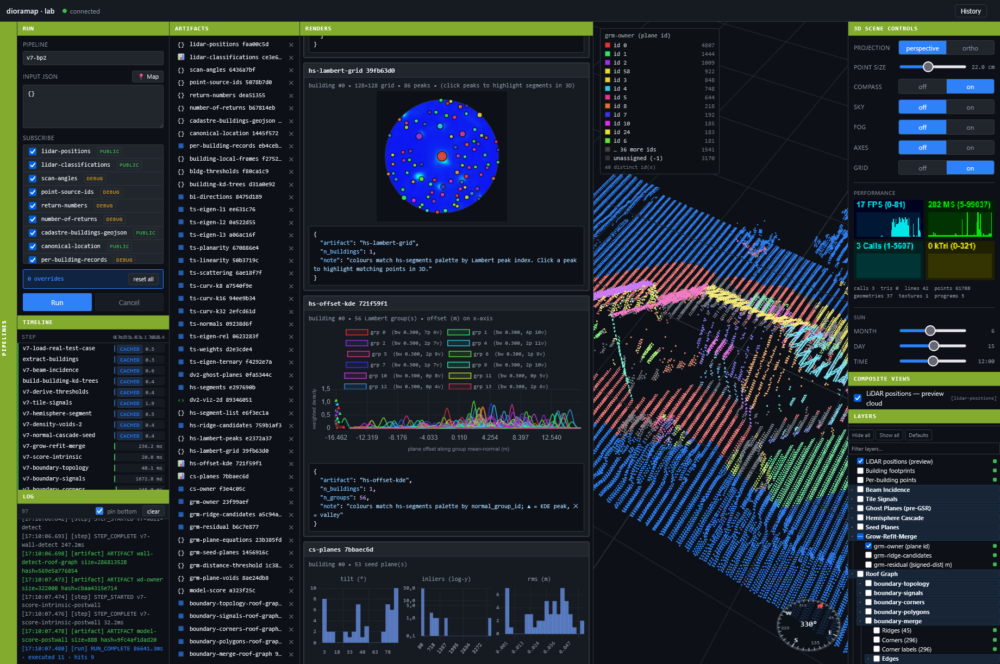
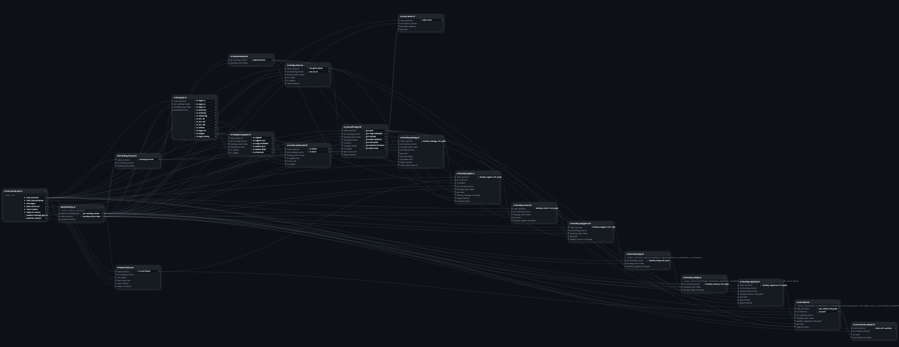

# Lab UI

The browser workbench for the Dioramap Lab engine. It connects to
`dioramap-processor serve` over WebSocket, runs any pipeline from the catalog, and
shows every artifact the run produces.



## Run it

```bash
# from the repo root, after building the engine (see the main README)
./build/dioramap-processor serve --pipelines-dir pipelines/smoke   # ws://127.0.0.1:7801
cd apps/lab-ui && npm ci && npm run dev                            # http://127.0.0.1:5181
```

Requires Node.js 20+.

## What's on screen

The **Run** panel:
- pick a pipeline;
- give its input JSON, or use **Map** to choose a place on IGN basemaps;
- choose which artifacts to subscribe to (`PUBLIC` or `DEBUG`);
- override step parameters.

The **Timeline** shows each step's state and duration. Steps served from the
content-addressed cache show as `CACHED`.

The **Artifacts** column lists every output by name and content hash.

The **Renders** column shows each artifact's visualizer output: charts, 2D grids and
a JSON inspector.

The **3D view** has:
- the point cloud and per-step layers (seeds, grown planes, roof graph, corners, edges…);
- projection, sun and display controls.

**History** lists previous runs.

The DAG view draws the pipeline as a graph of steps and the artifacts that connect
them. Each node shows its run state.



How artifacts become charts and 3D layers is described in
[docs/VISUALIZERS.md](../../docs/VISUALIZERS.md).
